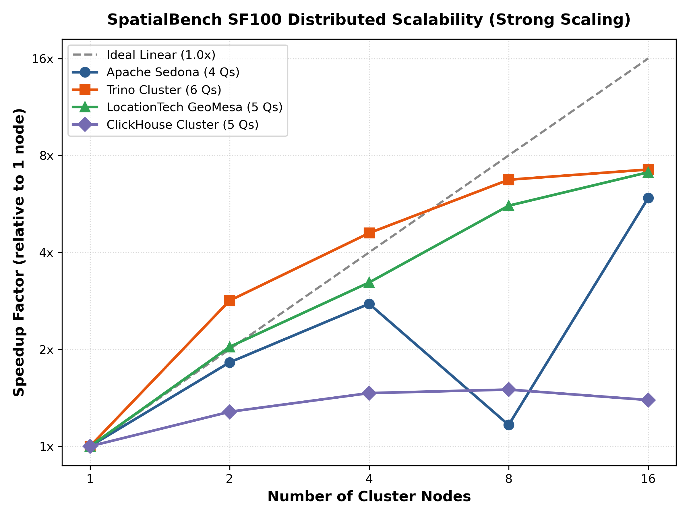
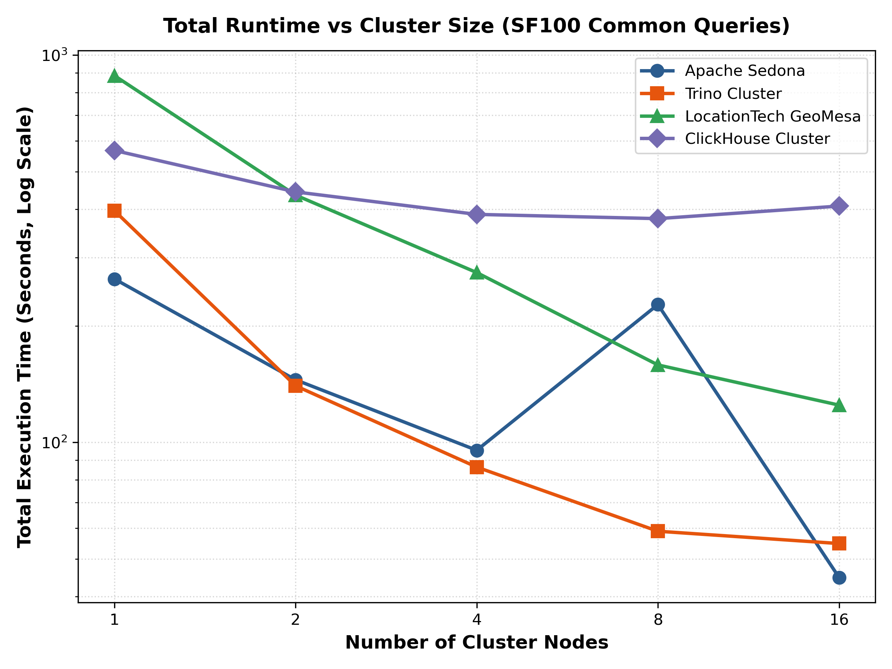

# SpatialBench SF100 Distributed Cluster Scalability Report

## 1. Strong Scaling Summary Table

| Engine | Common Queries | 1 Node | 2 Nodes | 4 Nodes | 8 Nodes | 16 Nodes | 16-Node Speedup | Parallel Efficiency |
| :--- | :--- | :--- | :--- | :--- | :--- | :--- | :--- | :--- |
| **Apache Sedona** | 4 Qs | 264.19s | 145.04s | 95.40s | 226.87s | 44.79s | 5.90x | 36.9% |
| **Trino Cluster** | 6 Qs | 396.31s | 139.94s | 86.32s | 58.96s | 54.80s | 7.23x | 45.2% |
| **LocationTech GeoMesa** | 5 Qs | 884.83s | 434.85s | 274.38s | 158.46s | 124.79s | 7.09x | 44.3% |
| **ClickHouse Cluster** | 5 Qs | 567.08s | 443.26s | 387.81s | 378.15s | 407.45s | 1.39x | 8.7% |

## 2. Speedup Curve

## 3. Total Latency Scaling Curve

